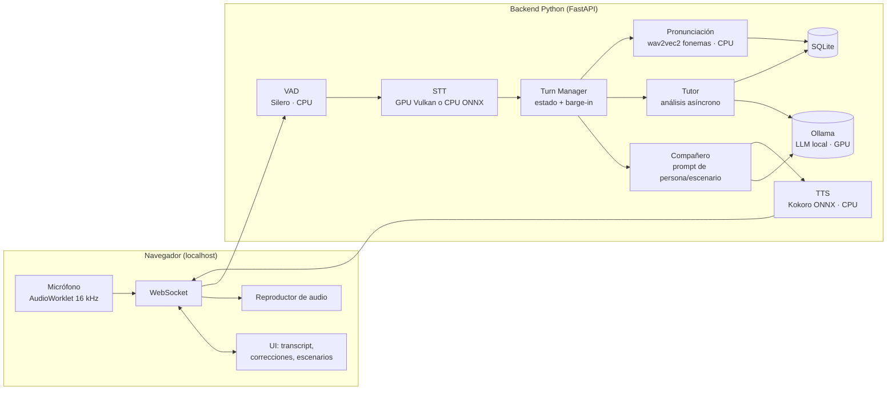

# IABuddy — Documento de diseño

> Estado: borrador v0.2 · Fecha: 2026-10-28 · Autor: Amado · Cambios v0.2: Windows 11, Python 3.12, repo público, audífonos, tecla para hablar + silencio configurable, acento US

## 1. Objetivo

Una app que funcione como **compañero de práctica de speaking en inglés**, que corra **100 % en local** y responda **en tiempo real** por voz.

- Usuario objetivo: hispanohablante, nivel **B1–B2**.
- Modos: **conversación libre**, **roleplay/escenarios**, **corrección y feedback**, **pronunciación**.
- Interfaz: **web local** (navegador en `localhost`) con **backend Python**.
- Hardware: PC con **Windows 11** y **AMD Radeon RX 9070** (RDNA4, gfx1201, 16 GB VRAM). Se usa con **audífonos**.
- Stack base: **Python 3.12** + `uv`, Windows nativo (sin WSL2). Repositorio **público en GitHub** (`IABuddy`, licencia MIT). Modelos en **`C:\Models`**.

### Fuera de alcance (por ahora)
- Servicios en la nube o APIs de pago.
- Móvil y multiusuario.
- Otros idiomas distintos al inglés (el diseño no lo impide, pero no se optimiza para ello).

## 2. Requisitos no funcionales

| Requisito | Meta |
|---|---|
| Latencia de turno (fin de tu frase → primera palabra del compañero) | **< 1,5 s**, ideal < 1 s |
| Privacidad | Ningún audio ni texto sale de la máquina |
| Interrupción (barge-in) | Al pulsar la tecla de hablar mientras el compañero habla, se calla en < 300 ms |
| VRAM total | ≤ 13 GB (dejar margen para el sistema) |
| Arranque | Un solo comando levanta todo |

## 3. Restricción principal: AMD en Windows

Buena parte del ecosistema de voz local supone CUDA. Con AMD en Windows hay tres vías de aceleración y **el modelo exacto de GPU decide cuál se puede usar**:

| Vía | Qué cubre | Notas |
|---|---|---|
| **Vulkan** (llama.cpp / Ollama / whisper.cpp) | Cualquier Radeon moderna | La opción más portable; Ollama la trae activa por defecto en Windows |
| **ROCm/HIP en Windows** (Ollama) | RX 7600–7900 (RDNA3) | Algo más rápido que Vulkan en las GPUs soportadas |
| **PyTorch + ROCm en Windows** | RX 9070/9060 XT, 7900 XTX… (lista corta) | Útil solo si algún componente exige PyTorch |
| **CPU / ONNX Runtime** | Todo | Suficiente para modelos pequeños (VAD, TTS, fonemas) |

### Situación concreta con la RX 9070 (verificado 2026-10-28)

| Vía | ¿Disponible con RX 9070 en Windows? | Implicación |
|---|---|---|
| Vulkan (llama.cpp / Ollama / whisper.cpp) | **Sí** | Vía principal. Ollama la usa por defecto en Windows |
| ROCm en Ollama para Windows | **No** (la lista de Windows solo incluye RDNA3; la 9070 sale solo en Linux) | No importa: Ollama cae a Vulkan |
| llama.cpp ROCm vs Vulkan | Ambos posibles, pero en la RX 9070 **Vulkan iguala o supera a ROCm** (≈120 vs ≈115 tok/s en generación con un 7B Q4; prefill ≈3.160 vs ≈2.380 tok/s) | Usar Vulkan |
| PyTorch + ROCm en Windows | **Sí** (RX 9070 está en la lista oficial, solo Windows 11) | Puerta abierta para componentes que exijan PyTorch, sin depender de ello |

Estimación: con un 7B Q4 a ~120 tok/s, un modelo de 12–14B debería rondar **55–70 tok/s**, de sobra para conversación (una respuesta de 3 frases ≈ 60 tokens). A medir en el spike R2.

**Decisión de diseño:** el stack **no depende de CUDA**. El LLM y el STT pesado van en GPU **vía Vulkan**; lo ligero va en CPU con ONNX Runtime. PyTorch+ROCm queda como **opción secundaria** (p. ej. para acelerar el modelo de fonemas o probar un TTS más expresivo), no como requisito: así la app no se rompe si una actualización de drivers o de ROCm falla.

Descartados por esta razón: `faster-whisper` (CTranslate2 es solo CUDA), NeMo/PyTorch para Parakeet en GPU.

## 4. Arquitectura

Pipeline **en cascada** (VAD → STT → LLM → TTS) en lugar de un modelo speech-to-speech. Motivo: cada etapa es intercambiable, el texto intermedio es justo lo que necesitan el tutor y el feedback, y los modelos speech-to-speech locales todavía no son fiables en AMD/Windows.



### Procesos
1. **Ollama** (proceso aparte) — sirve el LLM con Vulkan o ROCm.
2. **Backend FastAPI** — orquesta todo; carga VAD, TTS y el modelo de fonemas en memoria (ONNX Runtime).
3. **STT** — en proceso (ONNX) o como `whisper-server` de whisper.cpp con Vulkan, según el resultado del spike (ver §9).
4. **Frontend** — estático, servido por FastAPI. Sin framework pesado al inicio.

## 5. Componentes (elección inicial)

| Etapa | Candidato principal | Alternativa | Dónde corre |
|---|---|---|---|
| VAD / detección de fin de turno | Silero VAD (ONNX) | — | CPU |
| STT | whisper.cpp `large-v3-turbo` con Vulkan | Parakeet TDT 0.6B (ONNX vía sherpa-onnx / onnx-asr) | GPU / CPU |
| LLM | Modelo instruct 8–14B en Q4 (familias Qwen / Gemma / Llama; se elige en el spike) | Modelo 4–8B si la latencia no da | GPU |
| TTS | Kokoro-82M (ONNX), voces en **inglés US** | Piper | CPU |
| Fonemas (pronunciación) | wav2vec2 con salida en fonemas (espeak) exportado a ONNX + `phonemizer`/espeak-ng | — | CPU |
| Persistencia | SQLite | — | Disco |

### Presupuesto de VRAM aproximado
- LLM 12–14B Q4 + caché KV: ~9–10 GB
- Whisper large-v3-turbo (si va en GPU): ~1,5–2 GB
- Resto en CPU → **total ~11–12 GB**, dentro de los 16 GB.

## 6. Flujo de un turno y latencia

1. El navegador envía PCM de 16 kHz en tramas de 20–30 ms por WebSocket.
2. **Abres el turno con una tecla** (propuesta: Espacio). Silero VAD sigue la voz y cierra el turno tras un **silencio configurable** (por defecto ~800 ms, a ajustar en el spike S4), o cuando vuelves a pulsar la tecla. La tecla evita que ruidos o tu respiración disparen turnos falsos.
3. STT transcribe el segmento completo (palabras con timestamps y confianza).
4. El LLM genera en *streaming*; el texto se corta por **frases** y cada frase va a TTS en cuanto termina.
5. El audio de la primera frase empieza a sonar mientras se generan las siguientes.
6. En paralelo (sin bloquear la respuesta), el **tutor** y el **evaluador de pronunciación** analizan tu turno.

| Etapa | Presupuesto |
|---|---|
| Fin de turno (silencio VAD configurable; 0 si cierras con la tecla) | 0–800 ms |
| STT | 200–400 ms |
| LLM hasta la primera frase | 300–500 ms |
| TTS primera frase | 100–200 ms |
| **Total** | **~1,0–1,7 s** |

**Barge-in:** si pulsas la tecla mientras suena el compañero → se detiene la reproducción en el navegador, se cancela la generación del LLM, se descarta el audio pendiente y se abre tu turno. Al ser explícito (y con audífonos) no hay falsos positivos por eco.

**Contención de GPU:** el tutor usa el mismo LLM. Para que no retrase la respuesta del compañero, el Turn Manager lanza el análisis del tutor **después** de que la respuesta del compañero haya terminado de generarse (mientras suena el audio o mientras hablas), con una cola de prioridad: compañero > tutor.

## 7. Modos de práctica

### 7.1 Conversación libre
- Persona del compañero: amable, curioso, respuestas de **1–3 frases**, siempre devuelve una pregunta para mantenerte hablando.
- Vocabulario y velocidad ajustados a B1–B2 (velocidad de TTS configurable).
- **Corrección implícita (recast):** si dices *"Yesterday I go to the gym"*, el compañero responde *"Oh, you went to the gym yesterday? …"* sin interrumpir.
- Temas sugeridos o libres.

### 7.2 Roleplay / escenarios
- Escenarios definidos en YAML: rol del compañero, contexto, objetivos que debes cumplir, vocabulario clave, criterio de fin.
- Ejemplos iniciales: entrevista técnica en inglés (backend Python), daily standup, pedir en un restaurante, check-in en hotel, small talk con un colega.
- Al terminar: checklist de objetivos cumplidos + frases útiles que no usaste.

```yaml
# scenarios/job_interview_backend.yaml (ejemplo)
id: job_interview_backend
title: "Entrevista técnica — Backend Python"
partner_role: "Hiring manager at a US startup, friendly but probing"
user_role: "Candidate for a remote senior backend role"
goals:
  - "Introduce yourself in under 1 minute"
  - "Describe a project you are proud of"
  - "Explain a technical trade-off you made"
  - "Ask the interviewer two questions"
key_vocabulary: [scalability, trade-off, ownership, deadline, stakeholder]
end_condition: "All goals covered or 15 minutes"
```

### 7.3 Corrección y feedback
- Por cada turno tuyo, el tutor devuelve **JSON estructurado** (Ollama soporta salidas con esquema):
  ```json
  {
    "original": "Yesterday I go to the gym",
    "corrected": "Yesterday I went to the gym",
    "issues": [
      {"type": "grammar", "span": "go", "fix": "went", "explanation": "Pasado simple con 'yesterday'."}
    ],
    "better_alternatives": ["I hit the gym yesterday"],
    "severity": "medium"
  }
  ```
- La UI lo muestra en un **panel lateral** sin interrumpir la conversación (configurable: silencioso / panel / el compañero corrige en voz).
- **Resumen de sesión:** errores recurrentes, vocabulario nuevo, frases para repasar, métricas (palabras por minuto, longitud media de tus turnos, % de turnos sin errores).
- Explicaciones en español por defecto (configurable).

### 7.4 Pronunciación
- **Modo pasivo:** durante la conversación se marcan palabras con baja confianza de STT o puntuación fonémica baja.
- **Modo drill:** la app propone frases (o reutiliza las que fallaste); las lees y obtienes una puntuación por palabra y por fonema.
- Método: fonemas esperados (espeak-ng `en-us` a partir del texto) vs. fonemas reconocidos por wav2vec2 → alineación y distancia por fonema (aproximación tipo GOP). Referencia de pronunciación: **inglés americano**.
- Foco en errores típicos de hispanohablantes: /ɪ/ vs /iː/ (*ship/sheep*), /v/ vs /b/, /ʃ/ vs /tʃ/, /z/, terminaciones *-ed*, *s* inicial (*"espeak"*), /θ/ /ð/, schwa.

## 7.5 Gamificación

**Principio:** la XP premia **hablar**, nunca castiga errores (un B1–B2 necesita perder el miedo a equivocarse).

| Elemento | Regla inicial (ajustable) |
|---|---|
| XP por hablar | +5 XP por minuto en el que tú hablas |
| XP por turno largo | +5 XP por turno de más de 15 palabras |
| Meta diaria | 5/10/15/20/30 min hablando (por defecto 15) · +25 XP al cumplirla |
| Racha | Días seguidos cumpliendo la meta · bonus de XP según la racha · 1 protector por semana (día libre) |
| Niveles | Umbrales de XP crecientes, con nombre (p. ej. 7 · Conversador, 8 · Narrador) |
| Escenarios | +30 XP por objetivo, +50 XP si cumples todos · 1–3 estrellas (terminarlo / la mitad / todos) |
| Pronunciación | +XP por frase · cada sonido tiene niveles 1–5; sube al pasar de 85 en 3 sesiones distintas |
| Retos semanales | 3 retos por semana (minutos, escenarios, sonidos débiles) con XP extra |
| Logros | Hitos de constancia, escenarios, pronunciación y duración |
| Opciones | Ocultar XP durante la sesión · activar/desactivar protector de racha |

Sin rankings ni comparación con otros: es una app de un solo usuario.

## 8. Datos y persistencia (SQLite)

| Tabla | Contenido |
|---|---|
| `sessions` | id, modo, escenario, inicio/fin, duración |
| `turns` | sesión, hablante, texto, timestamps, (opcional) ruta del audio |
| `corrections` | turno, tipo, span, corrección, explicación |
| `pronunciation_scores` | turno/drill, palabra, fonema, puntuación |
| `vocabulary` | término, primera vez visto, veces usado, estado de repaso |
| `xp_events` | fecha, origen (minutos, turno largo, objetivo, reto, logro), cantidad |
| `daily_activity` | día, minutos hablados, meta cumplida, protector usado |
| `achievements` | id, fecha de desbloqueo, progreso |
| `sound_mastery` | fonema/grupo, nivel 1–5, historial de puntuaciones |
| `weekly_challenges` | semana, reto, progreso, completado |

Guardar audio será **opcional** (útil para escucharte después, pero ocupa disco).

## 9. Riesgos y spikes de validación (Fase 0)

| # | Riesgo | Spike |
|---|---|---|
| R1 | **Whisper "arregla" tus errores**: tiende a producir texto fluido y normalizado, lo que puede ocultar justo los errores que queremos detectar | Grabar 20–30 frases propias con errores reales y comparar transcripción literal de whisper.cpp vs. Parakeet (CTC/TDT suele ser más literal) |
| R2 | Latencia LLM en Vulkan insuficiente con un modelo 12–14B, sobre todo con el tutor compitiendo por la GPU | Medir tokens/s y tiempo a primer token de 2–3 modelos en la RX 9070 con Ollama (Vulkan), con y sin una petición del tutor en paralelo |
| R3 | Fin de turno cortando tus pausas de pensamiento | Mitigado por la tecla para cerrar el turno; ajustar el silencio por defecto en S4 |
| R4 | Precisión del scoring de pronunciación para acento hispano | Probar con pares mínimos grabados y verificar que detecta diferencias |
| R5 | Eco: el micrófono capta la voz del compañero | **Resuelto por diseño**: audífonos + barge-in con tecla |

## 10. Estructura del repositorio propuesta

```
APP_SPEAKING/
├── docs/
│   └── DISENO.md
├── backend/
│   ├── main.py              # FastAPI + rutas + WebSocket
│   ├── config.py
│   ├── pipeline/
│   │   ├── vad.py
│   │   ├── stt.py           # interfaz común + implementaciones whisper.cpp / parakeet
│   │   ├── llm.py           # cliente Ollama en streaming
│   │   ├── tts.py
│   │   └── turn_manager.py  # máquina de estados del turno + barge-in + cola de prioridad
│   ├── partner/             # prompts de persona y lógica de escenarios
│   ├── tutor/               # análisis de errores y resumen de sesión
│   ├── pronunciation/
│   ├── storage/
│   └── scenarios/*.yaml
├── frontend/
│   ├── index.html
│   ├── app.js
│   └── audio-worklet.js
├── spikes/                  # scripts de la Fase 0
├── tests/
└── pyproject.toml           # gestionado con uv
```

Cada etapa del pipeline implementa una interfaz (`STT`, `TTS`, `LLM`) para poder cambiar modelos sin tocar el resto.

## 11. Roadmap

| Fase | Entregable |
|---|---|
| **0 — Spikes** | Mediciones de R1–R2 en tu máquina; elección final de STT y LLM |
| **1 — Loop de voz (MVP)** | Conversación libre por voz en el navegador, con streaming y barge-in |
| **2 — Feedback** | Tutor asíncrono, panel de correcciones, resumen de sesión, SQLite |
| **3 — Escenarios** | Roleplay con YAML, objetivos y evaluación final |
| **4 — Pronunciación** | Modo pasivo + drills con puntuación por fonema |
| **5 — Progreso** | Historial, errores recurrentes, repaso de vocabulario |

## 12. Preguntas abiertas

1. ~~Modelo exacto de la GPU~~ → **RX 9070** · resuelto: Vulkan como vía principal (§3).
2. ~~Windows 10 u 11~~ → **Windows 11**.
3. ~~Acento~~ → **US**.
4. ¿Guardar grabaciones de tus sesiones?
5. Duración típica de una sesión (afecta al resumen y al manejo de contexto del LLM).
